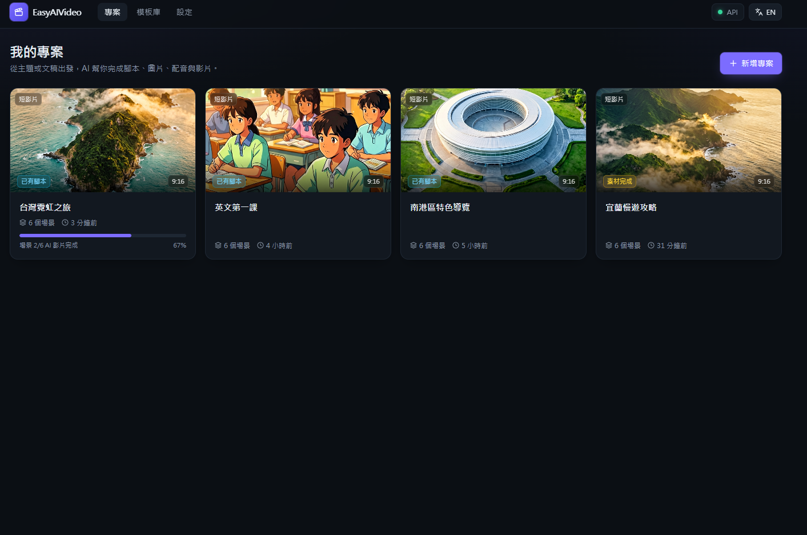
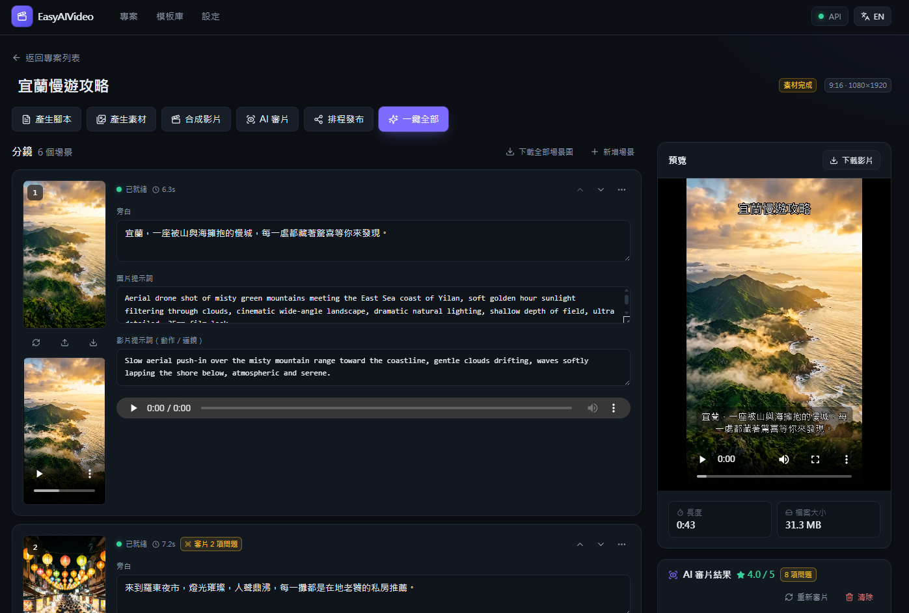
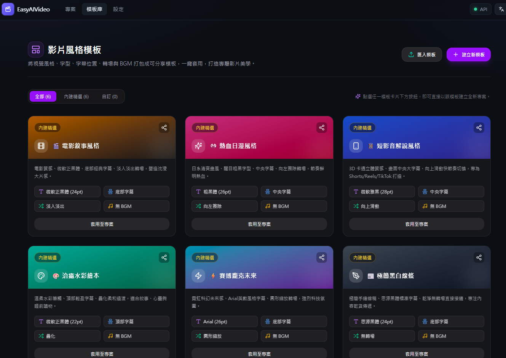
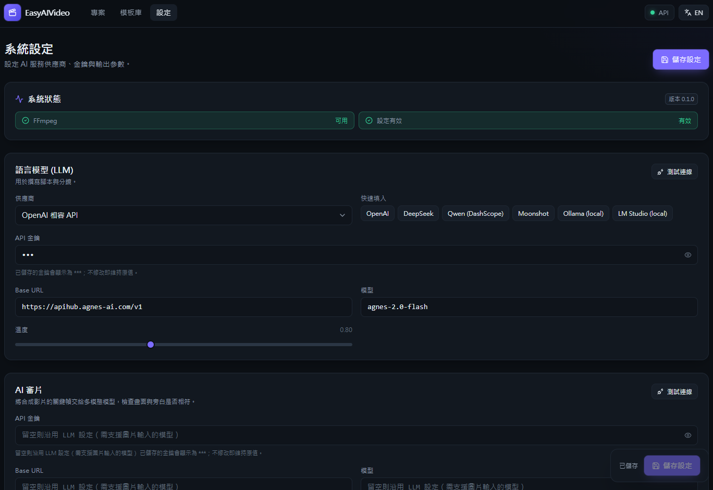

# EasyAIVideo

AI 短影片生成平台：輸入一個主題（或貼上你的文稿），系統自動撰寫腳本、為每個場景生成圖片與配音、加上字幕與背景音樂，最後合成一支完整影片。

提供「主題 → 分鏡 → 逐幀合成」的完整管線、專案制分鏡工作台、AI 審片評分、影片風格模板打包分享、以及 YouTube Shorts / TikTok 排程發布功能。

## 介面預覽

### 專案管理首頁
> 卡片式管理短影音專案，即時掌握生成進度與狀態。


### 影片分鏡工作台 & 即時預覽
> 逐場景自訂旁白、圖片提示詞與 AI 運鏡提示詞；右側即時預覽成片、抽幀 AI 審片評分，並支援社群排程發布。


### 影片風格模板庫
> 將視覺風格、字型、字幕位置、8 種畫面轉場與 BGM 打包成可攜帶模板，支援 Base64 分享代碼與 JSON 檔案匯出匯入。


### 系統設定與模型配置
> 自由配置 OpenAI 相容 LLM、Edge TTS、Agnes AI 影片、ComfyUI 以及 YouTube / TikTok 社群發布金鑰，支援各模組連線測試與沙盒模擬模式。


## 功能

- **主題生成腳本**：LLM 產生標題、每個場景的旁白與英文圖片提示詞；或直接使用自己的文稿自動分段。
- **影片風格模板系統**：將視覺風格、字型、字幕位置（底部／中央／頂部）、轉場特效（8 種 `xfade` 效果）與 BGM 一鍵打包為模板，支援 Base64 分享代碼與 JSON 檔案匯出匯入。
- **多供應商支援**：
  - LLM：任何 OpenAI 相容 API（OpenAI、DeepSeek、Qwen、Moonshot、Ollama、LM Studio…）或內建 mock。
  - 語音：Microsoft Edge TTS（免費）、OpenAI 相容 `/audio/speech`、或無聲模式。
  - 圖片：本地占位圖（離線測試）、OpenAI 相容 `/images/generations`（dall-e-3、gpt-image-1、各種代理）、ComfyUI 工作流。
  - 影片：ffmpeg Ken Burns 動態鏡頭（不需 AI 影片模型）、**Agnes AI 影片**（`agnes-video-v2.0`，文生影片／圖生影片／首尾幀）或 ComfyUI 圖生影片工作流。
- **分鏡工作台**：逐場景編輯旁白與圖片提示詞、重新產生單一場景的圖片或語音、上傳自己的圖片/語音/影片、新增/刪除/排序場景。
- **輸出與轉場特效**：直式 9:16、橫式 16:9、方形 1:1；支援自訂字幕字型、字級、位置（底部／中央／頂部）；8 種 FFmpeg 音畫平滑轉場特效（淡入淡出、疊化、擦除、滑動、縮放等）；背景音樂淡入淡出混音。
- **社群排程發布**：支援合成完自動發布或預約排程發布至 YouTube Shorts 與 TikTok，並提供沙盒模擬測試模式（Mock Mode）。
- **任務系統**：背景任務佇列、即時進度、可取消；伺服器重啟後自動標記中斷的任務。
- **繁中 / 英文介面**。

## 需求

- Python 3.11+ 與 [uv](https://docs.astral.sh/uv/)
- Node.js 20+（只在建置前端時需要）
- [ffmpeg](https://ffmpeg.org/)（含 ffprobe）在 PATH 上
- Windows 建議安裝微軟正黑體（系統預設有）以正確顯示中文字幕；Linux 請安裝 Noto Sans CJK，或把字型檔放進 `resources/fonts/`

## 快速開始

```bash
# Windows
start.bat

# macOS / Linux
./start.sh
```

腳本會自動安裝 Python 相依套件、建置前端（第一次），然後在 http://127.0.0.1:8000 啟動。

手動步驟：

```bash
uv sync
cd frontend && npm install && npm run build && cd ..
uv run easyaivideo --host 127.0.0.1 --port 8000
```

第一次啟動會在專案根目錄建立 `config.yaml`（預設為完全離線可跑的 mock / placeholder / edge 組合）。到 **設定** 頁面填入你的 LLM / 圖片供應商即可產出真正的 AI 內容。設定頁每個區塊都有「測試連線」。

## 使用流程

### 資產綁定、歷史版本與分鏡群組

- 工作台「共用資產庫」可新增角色、場景、道具的名稱、描述與選填參考圖；分集讀取並共用母系列的資產，也可引用原有角色與場景。
- 展開分鏡卡片頂部的群組／資產／版本區塊，勾選資產。綁定會保存當時的描述與參考圖副本，圖片生成優先使用明確綁定的素材，避免混入其他分鏡的角色參考。變更綁定後，現有畫面會標記為待更新。
- 新生成或上傳的首幀、尾幀與影片會保留歷史版本，可預覽並點選「使用此版本」。切換首尾幀會使既有影片過期；切換任何版本後需重新合成成片。此功能不會恢復升級前已刪除的檔案。
- 填寫分鏡群組名稱即可分組，上方按鈕可篩選各組；群組不會改變播放順序。「在下方新增」會沿用該分鏡群組。
- 歷史版本與綁定副本會增加磁碟使用量，刪除整個專案時一併清理。更新程式後請重新啟動後端並重新整理頁面。

1. **新增專案**：輸入主題或文稿，選擇語言、風格、比例、聲音、背景音樂、鏡頭動態。按「建立並開始生成」會直接跑完整流程。
2. **工作台**：腳本產生後可以逐場景修改旁白與提示詞；修改後的素材會標記「已過期」，按「產生素材」只會重做過期或缺少的部分。每張場景圖下方有三個按鈕：重新產生、上傳自己的圖片（也可直接把圖片拖到縮圖上）、下載；分鏡標題列的「下載全部場景圖」會打包所有場景圖與 AI 片段成 zip。
3. **合成影片**：所有場景都有圖片與語音後按「合成影片」，右側即可預覽與下載。

也可以直接呼叫 REST API（Swagger UI 在 `/docs`，完整契約見 [docs/API.md](docs/API.md)）。

## 長文／小說 → 分集影片（參考 ArcReel）

新增專案時選擇「長文／小說 → 分集影片」，即進入系列工作台：

1. **匯入文檔**：上傳 `.txt` `.md` `.docx` `.epub` `.pdf`（自動偵測 UTF-8 / Big5 / GB18030）或直接貼上文字，可多檔累加。
2. **分析內容**：LLM 產出故事概要（概要、類型、主題、世界觀）、主要角色（性格描述、英文外觀描述、性別、自動配對的語音）與常見場景。角色與場景都可手動修改，並可用圖片供應商「生成角色圖」。
3. **規劃分集**：依「每集目標長度」把全文按段落切成連續的集數，LLM 補上每集標題與摘要；標題與摘要可編輯。
4. **生成集數**：每一集都是獨立的子專案，沿用一般的分鏡工作台。腳本改編時會帶入概要、角色外觀與場景，讓各集圖片提示詞保持角色一致；可單集生成，也可「生成全部集數」排入佇列依序執行。
5. **兩種內容模式**：
   - 旁白解說：由旁白濃縮重述劇情，每個場景一段旁白。
   - 劇情演繹：角色各自說台詞（`speaker` 對應角色，使用該角色的語音），旁白補足敘述；字幕逐句依語音時間顯示並標示說話者。

## 目錄結構

## 目錄結構

```
easyaivideo/
  config.py            YAML 設定（可由 UI 熱更新）
  models.py            Project / Scene / Task 資料模型
  db.py                SQLite 持久化（專案 JSON、任務）
  prompts.py           LLM 提示詞
  providers/           llm / tts / image / video 供應商與 ComfyUI 客戶端
  services/
    pipeline.py        腳本 → 素材 → 合成 的核心管線；系列的分析、分集、角色圖
    series.py          文檔儲存、分集切分、子專案（集數）建立
    source_loader.py   txt / md / docx / epub / pdf 文字擷取
    task_queue.py      背景任務佇列
    ffmpeg.py          ffmpeg 合成（Ken Burns、疊字幕、串接、混 BGM）
    overlay.py         用 PIL 繪製標題/字幕透明圖層
    project_service.py 專案與場景編輯
  routers/             FastAPI 路由
frontend/              React + Vite + Tailwind 前端
data/
  projects/<id>/       每個專案的素材與輸出
  bgm/                 放入 mp3/wav 即會出現在背景音樂清單
  workflows/comfyui/   ComfyUI API 格式工作流（image_*.json / video_*.json）
```

## AI 影片生成（Agnes）

在 **設定 → 影片** 選擇 `agnes`，填入 Agnes API Key（與 LLM／圖片共用同一把即可），再把專案的「鏡頭動態」設為「AI 影片生成」：

| 模式 | 說明 |
|---|---|
| `i2v` 圖生影片 | 先生成場景圖，再以該圖為首幀生成影片（預設，角色與構圖最穩定） |
| `t2v` 文生影片 | 只用場景的影片提示詞生成，角色參考圖（若有）會一併送出 |
| `keyframes` 首尾幀 | 以本場景圖為首幀、下一場景圖為尾幀，鏡頭自然銜接到下一場 |

LLM 撰寫腳本時會為每個場景額外產生英文「影片提示詞」（動作、運鏡、氛圍），工作台可修改。每段片長取旁白長度並限制在 `max_clip_seconds`（最多 18 秒），旁白更長時合成階段會循環片段。Agnes 影片沒有音軌，語音、字幕與 BGM 仍由 ffmpeg 合成。

圖片若也使用 Agnes（`image.provider: openai_compat`、`base_url` 指向 apihub、`model: agnes-image-2.1-flash`），請把 `size_mode` 設為 `exact`，並可開啟 `use_references` 讓場景圖以角色圖為參考，維持角色一致。

## AI 審片

影片合成完成後，工作台按「AI 審片」：系統從成品逐場景抽取關鍵幀（預設每場景 2 張），連同該場景的旁白、原始圖片提示詞與角色外觀送給多模態模型，回報：

- 每個場景的評分（1–5）、畫面與旁白不符之處（例如旁白提到的主體不在畫面、地點或時間錯誤、畫面出現亂碼文字、角色外觀不一致、肢體或臉部變形）。
- 評分偏低時附上修正後的英文圖片提示詞，可一鍵套用並重新產生圖片，再重新合成。
- 整體摘要，指出優先修正的場景。

設定 → 審片 可指定多模態模型；留空則沿用 LLM 設定（需為支援圖片輸入的 OpenAI 相容模型，例如 Agnes 多模態模型、gpt-4o、qwen-vl）。「測試連線」會送一張合成小圖確認模型看得見圖片。

## ComfyUI 工作流

把 ComfyUI 以「Save (API Format)」匯出的工作流放到 `data/workflows/comfyui/`，檔名以 `image_` 或 `video_` 開頭，並把需要代入的欄位改成佔位字串：

| 佔位符 | 圖片工作流 | 影片工作流 |
|---|---|---|
| `"{{prompt}}"` / `"{{negative_prompt}}"` | ✓ | ✓ |
| `"{{width}}"` / `"{{height}}"` / `"{{seed}}"` | ✓ | ✓ |
| `"{{image}}"`（EasyAIVideo 會先上傳場景圖片） | | ✓ |
| `"{{fps}}"` / `"{{frames}}"` / `"{{duration}}"` | | ✓ |

被引號包住的佔位符會依型別代入（數字不加引號）。內附的 `image_default.json`（SDXL）與 `video_default.json`（SVD + VideoHelperSuite）是範本，請改成你實際擁有的模型檔名。

## 設定檔

見 [config.example.yaml](config.example.yaml)。環境變數：

- `EASYAIVIDEO_CONFIG`：設定檔路徑（預設 `./config.yaml`）
- `EASYAIVIDEO_DATA_DIR`：資料目錄（預設 `./data`）

## 授權

Apache-2.0

### Fish Audio 繁體中文配音

在「設定 → 語音合成」選擇 **Fish Audio API**，填入 API Key、女聲與男聲的 Voice ID，選擇預設配音並儲存。可用「測試連線」合成繁體中文測試句。Voice ID 請從 Fish Audio 音色頁取得，選擇適合臺灣華語的音色；實際口音與聲音性別由該音色決定。

專案及角色配音選單提供「繁體中文 女聲」與「繁體中文 男聲」。切換後，舊專案中的 Edge 音色會依原性別對應到 Fish Audio；原有 EdgeTTS 仍可選用。Fish Audio 的金鑰與模型設定獨立保存，API Key 不會以明文回傳至前端。

預設 API 網址為 `https://api.fish.audio/v1`，模型為 `s2.1-pro`，可依帳號可用模型調整。設定範例見 `config.example.yaml` 的 `tts.fish_audio`。
API 介面依據 [Fish Audio 官方 TTS 文件](https://docs.fish.audio/api-reference/endpoint/openapi-v1/text-to-speech)。

### Agnes Video 2.5 與 2.5 Flash

支援 `agnes-video-2.5-flash`（目前限時免費 `$0 / 秒`）與 `agnes-video-2.5`（標準付費版）。
- **參數規格**：依據 Agnes 官方規範傳送 `seconds`（4–12 秒）、`size`、`mode`（`text` / `keyframe` / `reference`）、`aspect_ratio` 與 `first_frame`/`last_frame`，不傳送不可配置的舊版欄位。
- **解析度相容**：`agnes-video-2.5-flash` 僅支援 720P，若系統解析度設為 1080p 或 480p 會自動適配為 720P 生成，不會拋錯中斷工作流。
- **圖片來源彈性**：優先使用 Agnes 圖片生成的公開網址（依 `.source.json`）；本機上傳圖片、修改後圖片或無公開網址的圖片，會自動轉為 Agnes 官方支援的 Base64 Data URI 提交，不再強制要求重新產圖。
- **佇列滿載與重試**：由於 Flash 為限時免費模型，伺服器尖峰時段常出現 `503 video_queue_full`。系統已配置智慧退避排隊機制（間隔 28~32 秒，避免觸發免費用戶 429 頻率限制），自動重試排隊名額。
- **查詢機制**：完成提交後以 `video_id` 及 `model_name` 輪詢 `/agnesapi` 直至成片下載。

